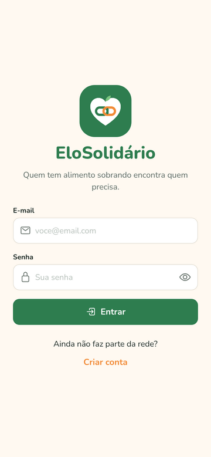
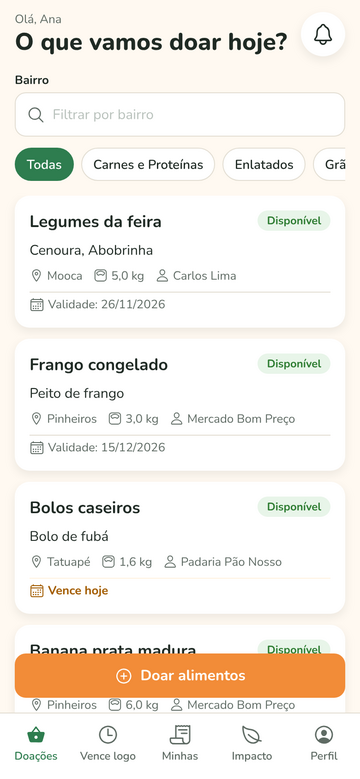
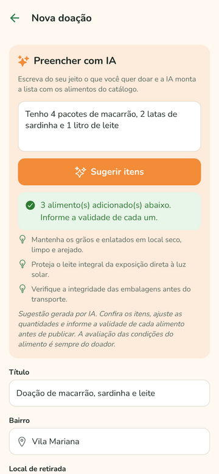
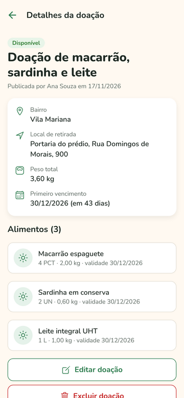
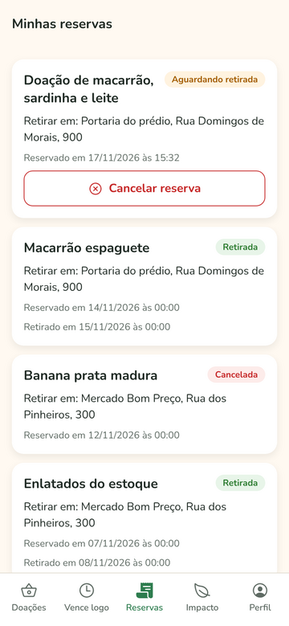
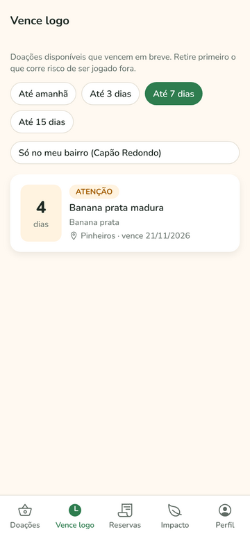
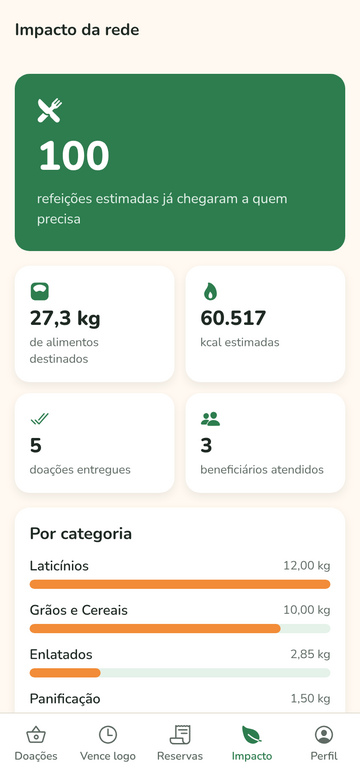
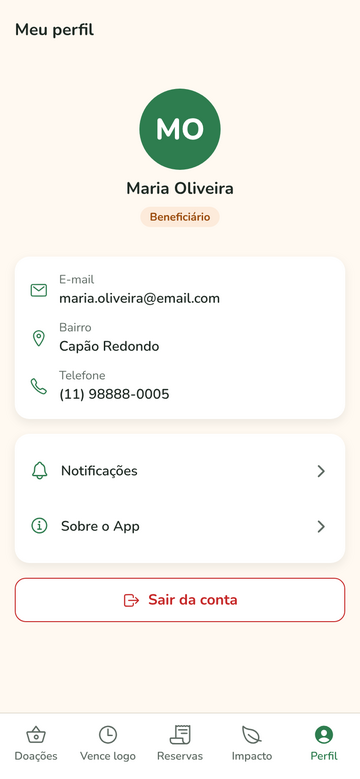
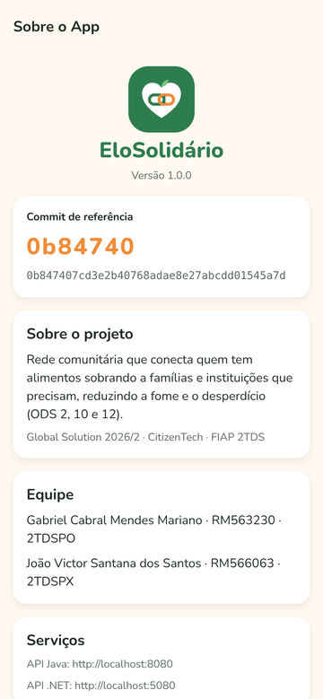

# EloSolidário — Mobile Application Development

Global Solution 2026/2 · CitizenTech · FIAP 2TDS

| Integrante                     | RM     | Turma  |
| ------------------------------ | ------ | ------ |
| Gabriel Cabral Mendes Mariano  | 563230 | 2TDSPO |
| João Victor Santana dos Santos | 566063 | 2TDSPX |

- **Stack:** React Native com **Expo** (SDK 58), Expo Router, TypeScript, Axios e AsyncStorage
- **Vídeo (até 3 min):** https://youtu.be/GhTBn2tK7XU
- **Versão web (Render):** https://elo-solidario-mobile.onrender.com

## O app

O **EloSolidário** conecta quem tem alimentos sobrando (moradores, mercados e padarias) a famílias e instituições que precisam, combatendo a fome e o desperdício (ODS 2, 10 e 12).

- O **doador** publica uma doação com os alimentos do catálogo. Ele pode escrever do seu jeito e deixar a **IA preencher os itens**.
- O **beneficiário** encontra doações por bairro e categoria, vê primeiro **o que vence logo** e faz a reserva.
- O doador **confirma a retirada**, os dois recebem **notificações**, e a comunidade acompanha o **impacto** em kg, kcal e refeições.

## Telas

| Tela                         | Rota                                   | O que faz                                                                           |
| ---------------------------- | -------------------------------------- | ----------------------------------------------------------------------------------- |
| 1. Login                     | `/login`                               | Autenticação real na API Java, com validação e indicador de carregamento            |
| 2. Cadastro                  | `/cadastro`                            | Cria uma conta de doador ou de beneficiário                                         |
| 3. Doações (vitrine)         | `/`                                    | Lista paginada (scroll infinito), filtros por bairro e categoria, _pull to refresh_ |
| 4. Detalhe da doação         | `/doacao/[id]`                         | Reservar (beneficiário). Editar, excluir e confirmar a retirada (doador)            |
| 5. Nova / Editar doação      | `/doacao/nova` e `/doacao/[id]/editar` | Formulário com itens do catálogo e o assistente **"Preencher com IA"**              |
| 6. Minhas doações / reservas | `/atividade`                           | Histórico conforme o perfil, com cancelamento de reserva                            |
| 7. Vence logo                | `/urgentes`                            | Doações que vencem em até N dias (anti-desperdício)                                 |
| 8. Impacto                   | `/impacto`                             | Painel da rede e o selo solidário do doador                                         |
| 9. Notificações              | `/notificacoes`                        | Avisos de reserva, retirada e cancelamento (eventos do RabbitMQ)                    |
| 10. Perfil                   | `/perfil`                              | Dados do usuário e logout                                                           |
| Sobre o App                  | `/sobre`                               | Versão e **hash do commit** da build                                                |

<p>
  
  
  
  
  
</p>
<p>
  
  
  
  
  
</p>

## Requisitos da disciplina

| Requisito            | Como foi atendido                                                                                                                                                                                                                                                                                                                                                |
| -------------------- | ---------------------------------------------------------------------------------------------------------------------------------------------------------------------------------------------------------------------------------------------------------------------------------------------------------------------------------------------------------------- |
| 1. Telas e navegação | 10 telas + "Sobre o App" com **Expo Router** (rotas por arquivo em `src/app`): pilha (`Stack`) e abas (`Tabs`), com os títulos e o botão voltar padronizados                                                                                                                                                                                                     |
| 2. CRUD com API      | **Doações** com Create (`POST /doacoes`), Read (`GET /doacoes`, `GET /doacoes/{id}`), Update (`PUT /doacoes/{id}`) e Delete (`DELETE /doacoes/{id}`) na API **Java**, via **Axios**. O app também consome a API **.NET** (catálogo, impacto e vitrine anti-desperdício). Todas as telas têm carregamento, mensagem de erro com "tentar novamente" e estado vazio |
| 3. Autenticação      | Cadastro e login reais na API Java (JWT). O token fica no **SecureStore**. Logout limpa a sessão. As rotas internas são protegidas com `Stack.Protected` e, se o token expirar (401), o usuário volta ao login                                                                                                                                                   |
| 4. Estilização       | Paleta própria (verde, laranja e creme), fonte **Nunito** em `assets/fonts`, ícone, splash e ilustração próprios em `assets/images`. Áreas de toque com no mínimo 48 dp e `accessibilityLabel`/`accessibilityRole`, seguindo as guidelines de Android e iOS                                                                                                      |
| 5. Arquitetura       | Camadas separadas (abaixo), TypeScript estrito, **ESLint** (`eslint-config-expo`) e **Prettier**                                                                                                                                                                                                                                                                 |
| 6. Vídeo             | Até 3 minutos, com o link no início deste README e no `.txt` da entrega                                                                                                                                                                                                                                                                                          |
| 7. Publicação        | Opcional nesta entrega. O projeto já está configurado para gerar o APK pelo **EAS Build**, e a tela "Sobre o App" mostra o hash do commit da build                                                                                                                                                                                                               |

## Persistência local (AsyncStorage)

Os dados são gravados no próprio aparelho com o **AsyncStorage** (`src/storage/armazenamentoLocal.ts`), em três situações:

| O que fica salvo         | Chave                      | Para que serve                                                                                                                                               |
| ------------------------ | -------------------------- | ------------------------------------------------------------------------------------------------------------------------------------------------------------ |
| Rascunho da nova doação  | `elo:rascunho:{idUsuario}` | Salvo enquanto o doador digita. Se ele sair do app, o rascunho volta ao abrir "Nova doação", com a opção de descartar. É apagado quando a doação é publicada |
| Última vitrine carregada | `elo:vitrine`              | Sem conexão, a lista salva aparece com o aviso "Sem conexão" e a data em que foi salva                                                                       |
| Doações já abertas       | `elo:doacao:{id}`          | O detalhe pode ser consultado sem internet                                                                                                                   |

O token de login fica separado, no **SecureStore**, que é criptografado. No logout, a sessão e todos os dados `elo:` são apagados do aparelho.

## Arquitetura

```
src/
├── app/                    # Navegação (Expo Router): cada arquivo é uma tela
│   ├── _layout.tsx         # Fontes, splash, AuthProvider e proteção de rotas
│   ├── login.tsx
│   ├── cadastro.tsx
│   └── (app)/              # Área logada
│       ├── _layout.tsx     # Pilha das telas internas
│       ├── (abas)/         # Barra de abas: vitrine, vence logo, minhas, impacto e perfil
│       ├── doacao/         # Detalhe, nova e editar
│       ├── notificacoes.tsx
│       └── sobre.tsx
├── components/             # Componentes reutilizáveis (Botao, CampoTexto, CartaoDoacao...)
│   └── doacao/             # Formulário, seletor do catálogo e assistente de IA
├── contexts/               # AuthContext: sessão, login, cadastro e logout
├── services/               # Acesso às APIs (Axios): um serviço por recurso
├── storage/                # Sessão (SecureStore) e dados locais (AsyncStorage)
├── theme/                  # Cores, tipografia e espaçamentos
├── types/                  # Tipos dos contratos das APIs
└── utils/                  # Formatação, mensagens de erro e confirmação
assets/
├── fonts/                  # Nunito
└── images/                 # Símbolo e ilustração do app
```

Fluxo de uma requisição: **tela** → **serviço** (`src/services`) → **cliente Axios** (`api.ts`, que adiciona o token e trata o 401) → API. Os erros das duas APIs (o formato do Java e o ProblemDetails do .NET) são convertidos em mensagens amigáveis por `utils/erros.ts`.

### Decisões técnicas

| Decisão                                     | Motivo                                                                                          |
| ------------------------------------------- | ----------------------------------------------------------------------------------------------- |
| Expo Router em vez de React Navigation puro | Rotas por arquivo, deep links e rotas tipadas (`typedRoutes`). Usa o React Navigation por baixo |
| `Stack.Protected`                           | Proteção de rotas declarativa: sem login, as telas internas nem existem na navegação            |
| SecureStore para o token                    | Fica criptografado no Keystore (Android) e no Keychain (iOS), ao contrário do AsyncStorage      |
| Axios com interceptors                      | O token é colocado em um lugar só, e a sessão expirada (401) é tratada de forma central         |
| Data de validade com máscara                | Evita uma biblioteca nativa extra só para escolher datas                                        |
| Sem biblioteca de estado global             | O Context API basta para a sessão, e cada tela cuida dos próprios dados                         |

## Como executar

Pré-requisitos: Node 20+.

```bash
npm install
cp .env.example .env    # ajuste as URLs das APIs, se necessário
npx expo start
```

Com o servidor iniciado, pressione **`w`** para abrir o app no navegador. Também é possível ler o QR Code com o **Expo Go** ou pressionar **`a`** para abrir no emulador Android.

| Variável                     | Padrão                                      |
| ---------------------------- | ------------------------------------------- |
| `EXPO_PUBLIC_API_JAVA_URL`   | `https://elo-solidario-java.onrender.com`   |
| `EXPO_PUBLIC_API_DOTNET_URL` | `https://elo-solidario-dotnet.onrender.com` |

### Usuário de teste

| Perfil       | E-mail                     | Senha      |
| ------------ | -------------------------- | ---------- |
| Doador       | `ana.souza@email.com`      | `Elo@2026` |
| Beneficiário | `maria.oliveira@email.com` | `Elo@2026` |

Também é possível criar uma conta nova na tela de cadastro.

Verificações de código:

```bash
npm run lint
npm run typecheck
npx prettier --check .
```

## Publicação (opcional)

```bash
npx eas-cli@latest login
npx eas-cli@latest build -p android --profile preview
```

1. O perfil `preview` (`eas.json`) gera um **APK**.
2. No console do Firebase: **App Distribution** → enviar o APK → adicionar o e-mail do professor como **tester**.
3. O `app.config.js` grava na build o hash do commit (`EAS_BUILD_GIT_COMMIT_HASH`), que aparece na tela **Sobre o App**. Assim dá para conferir que a versão publicada é a mesma do código-fonte.

## Declaração de uso de IA

Ferramenta utilizada: Claude (Anthropic), como apoio na revisão do código, na explicação de conceitos do Expo Router e na revisão do texto deste README. O código foi revisado, executado e testado pelos integrantes.
